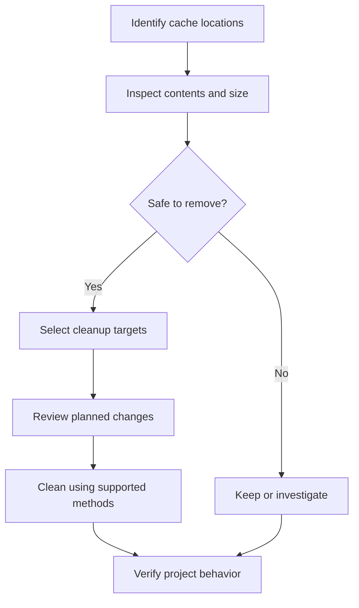

 

  

&nbsp;

&nbsp;

  

---

## 🌿 A Cleaner Workspace for AI-Assisted Development

**Claude Code Cache Manager** is a developer utility concept focused on understanding, organizing, and maintaining cache-related files in Claude Code workflows. As projects grow, temporary artifacts and cached data can become harder to navigate. A dedicated cache-management workflow helps developers make deliberate decisions about what to inspect, retain, or remove.

Rather than treating cleanup as a blind delete operation, this project emphasizes **visibility, control, and safe maintenance**. It is aimed at developers who want a more orderly local environment while working with AI-assisted coding tools.

> **Guiding principle:** Know what a cache contains before deciding whether it should be cleared.

## ✨ Why Cache Management Matters

| Advantage | Practical value |
|:--|:--|
| 🧭 **Better visibility** | Understand which temporary files and directories deserve attention. |
| 🧹 **Less clutter** | Keep development environments easier to navigate. |
| 💾 **Storage awareness** | Identify where cached artifacts may consume disk space. |
| 🛡️ **Safer decisions** | Review cleanup targets before taking destructive action. |
| 🔁 **Repeatable maintenance** | Build consistent habits for project housekeeping. |
| ⚡ **Focused workflow** | Spend less time investigating avoidable workspace clutter. |

## 🧰 Cache Management Essentials

<table>
<tr><td width="50%" valign="top">

### 🔎 Discover
Identify relevant cache locations and understand their purpose.

### 📊 Inspect
Check size, age, and ownership before making changes.

### 🗂️ Organize
Separate temporary artifacts from valuable project files.

</td><td width="50%" valign="top">

### 🎯 Select
Choose cleanup targets intentionally rather than deleting everything.

### 🧪 Validate
Confirm the development workflow still behaves as expected.

### 🔄 Maintain
Review cache growth periodically as projects evolve.

</td></tr>
</table>

## 🧭 The Cache Lifecycle

This diagram illustrates a **recommended maintenance approach**, not a claim about specific automated features in the distributed software.

## 🧑‍💻 Who Can Benefit?

| Audience | Useful goal |
|:--|:--|
| **Solo developers** | Keep personal AI-assisted coding environments organized. |
| **Project maintainers** | Establish repeatable workspace-cleanup practices. |
| **Students** | Learn how caches differ from source files and build outputs. |
| **Technical teams** | Document safe maintenance conventions for shared workflows. |
| **Power users** | Investigate disk usage and reduce unnecessary clutter. |

## 🚀 Get Claude Code Cache Manager

Access the project through the button below. The destination is the provided project resource; follow the instructions supplied there for any actual installation or configuration steps.

## 🧠 Good Habits for a Healthy Workspace

1. **Inspect before deleting.** Understand which application created the files.
2. **Keep source code separate.** Never confuse cache directories with project assets.
3. **Prefer supported cleanup methods.** Use documented application controls where available.
4. **Protect active sessions.** Avoid clearing data while a tool is writing to it.
5. **Check the result.** Reopen your workflow and confirm it functions normally.

## 🖼️ Project Interface

## ❓ Frequently Asked Questions

<b>What is Claude Code Cache Manager about?</b>

It focuses on cache awareness and workspace maintenance in the context of Claude Code development workflows.

<b>Why not delete every cache folder manually?</b>

Different caches serve different purposes. Some data can be regenerated, while other files may contain useful state or be in active use. Inspection helps avoid unnecessary disruption.

<b>Will clearing a cache always make a tool faster?</b>

No. Removing a cache may reclaim space, but it can also require the application to rebuild data later. The benefit depends on the cache and workflow.

<b>Where can I get the project?</b>

Use the project buttons above or below to open the supplied resource.

<b>Is this useful for beginners?</b>

Yes. Learning to distinguish temporary files, caches, logs, and source files is a useful development skill.

---

### Less clutter. More clarity.

  

⭐ **Enjoyed the project? Consider starring the repository.**

